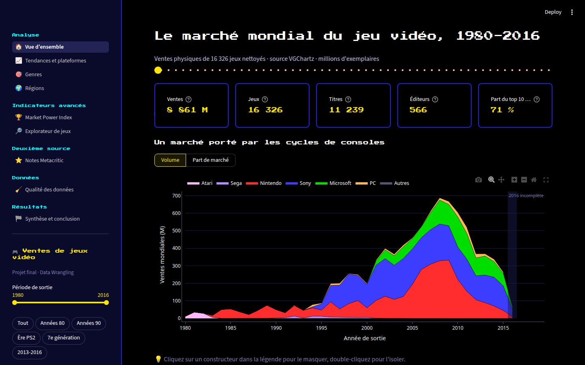
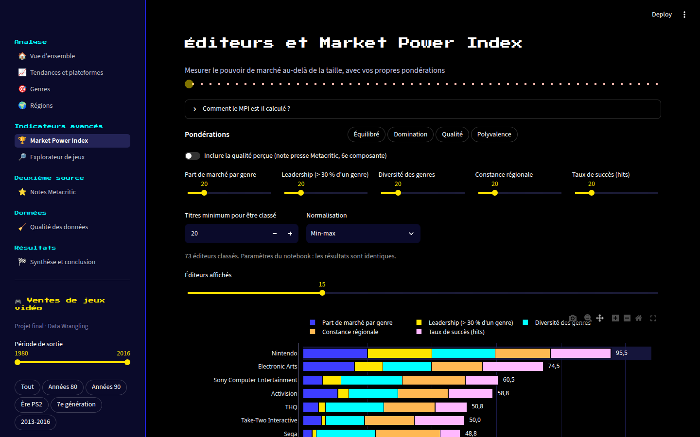
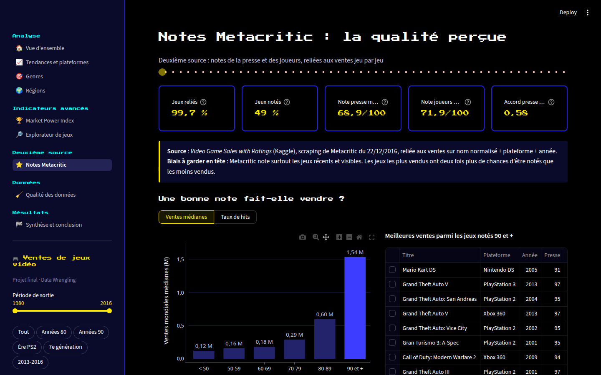
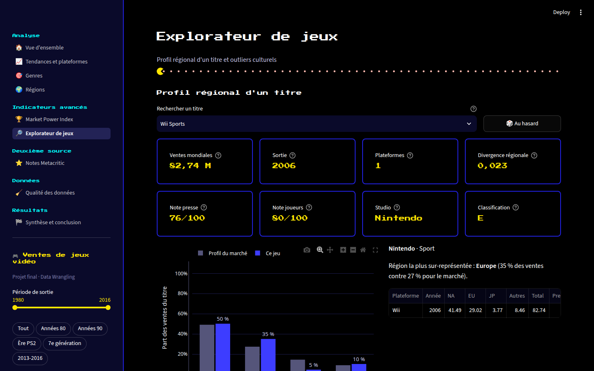
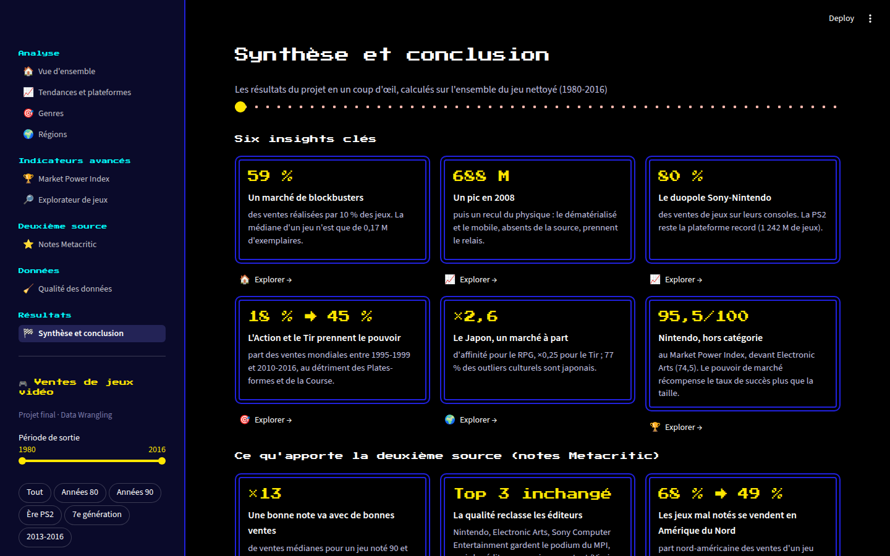
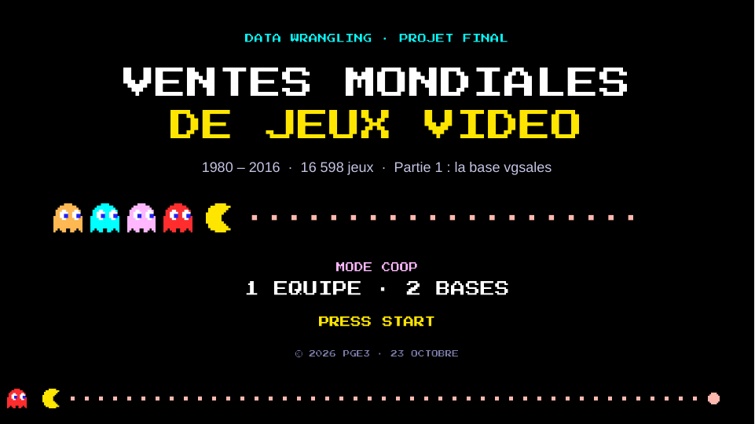
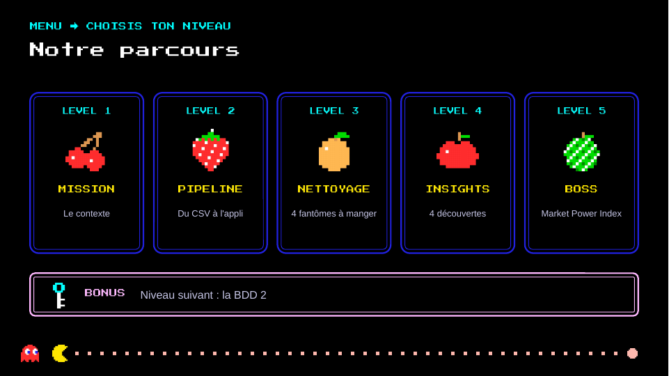
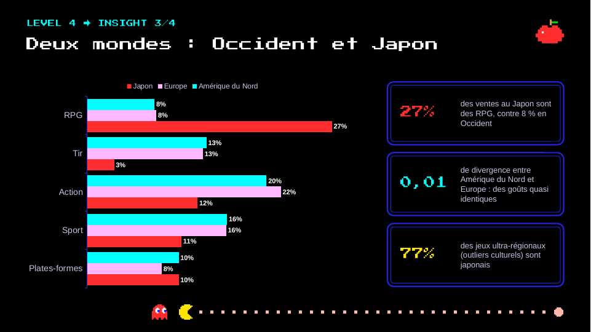
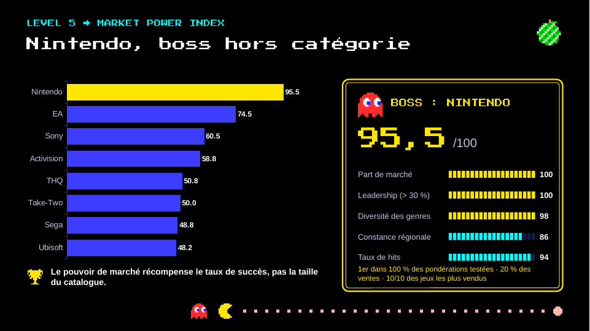
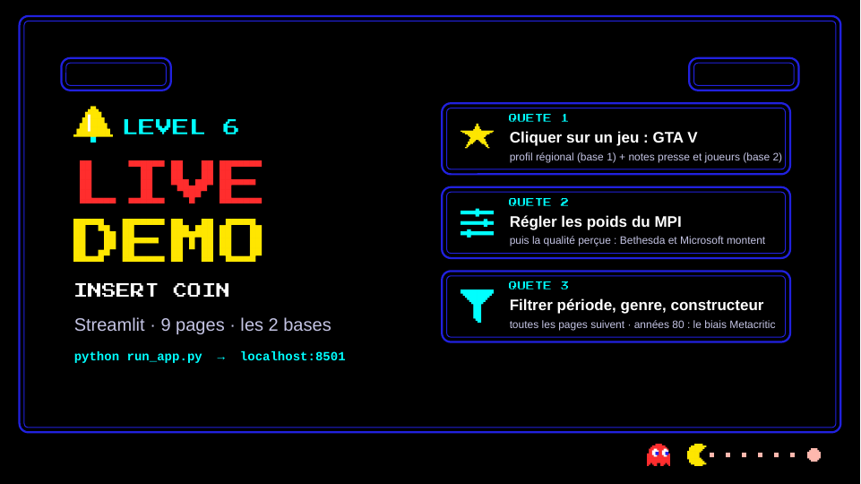

# Ventes mondiales de jeux vidéo (1980-2016)

Projet final de Data Wrangling : nettoyage, analyse exploratoire, indicateurs avancés et interface interactive, sur deux bases de données reliées entre elles :

- **BDD 1, les ventes** : `bdd1_vgsales.csv`, 16 598 jeux, ventes physiques en millions d'exemplaires (VGChartz) ;
- **BDD 2, les notes** : `bdd2_metacritic.csv`, 16 719 lignes, notes de la presse et des joueurs (Metacritic, via Kaggle).



## Deux pipelines, un même schéma

Chaque base suit son propre pipeline, de bout en bout : un notebook, ses modules, ses données et ses figures. Tous les fichiers d'un pipeline commencent par le même préfixe, `bdd1_` ou `bdd2_`. La jointure entre les deux bases fait partie du pipeline 2, qui part des ventes propres du pipeline 1.

| Étape | Pipeline 1 : ventes (`bdd1_`) | Pipeline 2 : notes + jointure (`bdd2_`) |
|---|---|---|
| Notebook | `bdd1_vgsales.ipynb` (+ `.html`) : parties I à III | `bdd2_metacritic.ipynb` (+ `.html`) : parties IV et V |
| Données brutes | `BDD_states/bdd1_vgsales.csv` | `BDD_states/bdd2_metacritic.csv` |
| Nettoyage | `modules/bdd1_cleaning.py` | `modules/bdd2_cleaning.py` (réutilise les règles du pipeline 1) |
| Données propres | `BDD_states/bdd1_vgsales_clean.csv` | `BDD_states/bdd2_metacritic_clean.csv` |
| Indicateurs / jointure | `modules/bdd1_indicators.py` → `bdd1_market_power_index.csv`, `bdd1_divergence_regionale.csv` | `modules/bdd2_jointure.py` → `bdd2_jointure_ventes_notes.csv`, MPI à 6 composantes |
| Figures | `figures/bdd1_01_…` à `bdd1_24_…` | `figures/bdd2_01_…` à `bdd2_14_…` (11 à 14 : jointure) |
| Documentation | | `docs/bdd2_dictionnaire.md`, `docs/bdd2_jointure.md` |

```
pipeline/
├── bdd1_vgsales.ipynb        bdd2_metacritic.ipynb      ← un notebook par pipeline (+ export .html)
├── BDD_states/               bdd1_*.csv  ·  bdd2_*.csv  (bruts, propres, indicateurs, jointure)
├── modules/                  bdd1_cleaning · bdd1_indicators · bdd2_cleaning · bdd2_jointure
│                             config.py (chemins, couleurs) · viz.py (style des figures), partagés
├── figures/                  bdd1_NN_*.png  ·  bdd2_NN_*.png
├── app/                      interface Streamlit (dashboard, views, charts, donnees, theme)
├── docs/                     bdd2_dictionnaire · bdd2_jointure · prix_prestation · captures/
├── presentation/             presentation_complete.pptx / .pdf (soutenance)
├── brouillons/               notebooks de travail d'origine, conservés tels quels
├── consignes.md              organisation de l'équipe
└── run_app.py · requirements.txt
```

## Installation

```bash
python -m venv .venv
source .venv/bin/activate          # Windows : .venv\Scripts\activate
pip install -r requirements.txt
```

Un environnement `.venv` déjà prêt est fourni dans le dossier (Linux).

## Lancer les notebooks

Ouvrir le notebook dans Jupyter ou VS Code, puis *Run All*, depuis ce dossier (les notebooks importent `modules/`).

- `bdd1_vgsales.ipynb` régénère `bdd1_vgsales_clean.csv`, les CSV d'indicateurs et les figures `bdd1_*`.
- `bdd2_metacritic.ipynb` s'exécute indépendamment du premier : il nettoie lui-même les ventes avec les mêmes règles, puis régénère `bdd2_metacritic_clean.csv`, `bdd2_jointure_ventes_notes.csv` et les figures `bdd2_*`.

## Lancer l'interface

```bash
python run_app.py
```

puis ouvrir http://localhost:8501. Les pages :

- **Vue d'ensemble** : chiffres clés, ventes par constructeur, top 10, messages clés
- **Tendances et plateformes** : jeux et ventes par année, cycle de vie des consoles, classement
- **Genres** : fréquence contre ventes, évolution, leaders par genre
- **Régions** : poids des régions, affinités genre-région, convergence des goûts
- **Market Power Index** : poids des 5 composantes réglables (et, en option, une 6e : la qualité perçue), fiche éditeur, export CSV
- **Explorateur de jeux** : profil régional de n'importe quel titre, outliers culturels
- **Notes Metacritic** (deuxième source) : taux de jointure, notes et ventes, presse contre joueurs, sensibilité des régions aux notes
- **Qualité des données** : journaux de nettoyage des deux bases, bilan de la jointure, export des jeux propres
- **Synthèse et conclusion** : les six insights clés et les trois apports de la deuxième source (recalculés sur les données), difficultés de data wrangling, apport des visualisations, galerie des figures des deux notebooks

| Market Power Index | Notes Metacritic |
|---|---|
|  |  |
| **Explorateur de jeux** | **Synthèse et conclusion** |
|  |  |

Le thème reprend le style arcade des diapos (fond noir, murs bleus, police pixel *Press Start 2P* sous licence OFL) : voir `app/theme.py`. Les figures des notebooks gardent leur palette claire.

La deuxième source enrichit aussi les pages existantes : la fiche d'un jeu affiche ses notes, son studio et sa classification d'âge ; le classement des plateformes affiche leur note moyenne ; la page Genres propose les notes par genre.

L'interface est interactive : un clic sur un jeu (barre, point ou ligne de tableau) ouvre sa fiche, un clic sur une année, un genre, une plateforme ou un éditeur affiche son détail, et les réglages (pondérations du MPI, jeu choisi...) sont conservés d'une page à l'autre. Les calculs sont mis en cache et chaque section réglable se recharge seule, sans recalculer toute la page.

Les filtres de la barre latérale (période, genres, constructeurs, type de plateforme) s'appliquent à toutes les pages d'analyse (la qualité des données et la synthèse portent sur le jeu complet). L'interface nettoie les données brutes au lancement avec les mêmes modules que les notebooks : un `assert_frame_equal` dans le notebook garantit que les deux donnent un résultat identique.

## Pipeline 1 : nettoyage des ventes

| Problème | Traitement |
|---|---|
| 271 années manquantes | 118 imputées (fiche jumelle ou autres plateformes du même titre, uniquement si elles concordent), 153 supprimées (0,5 % des ventes) |
| 58 éditeurs vides + 203 `Unknown` | une seule modalité `Inconnu` |
| Filiales (*Sony Computer Entertainment Europe*...) | rattachées à leur groupe ; les fusions historiques (SquareSoft, Enix) sont conservées |
| 4 sorties après 2016, 6 jeux datés avant leur console | 5 corrigées, 5 supprimées |
| 149 fiches partielles `(JP sales)`, doublons d'écriture | 114 fiches fusionnées (maximum par région, sans double comptage) |

Résultat : 16 326 jeux, 11 239 titres, 99,3 % du volume de ventes conservé.

## Pipeline 2 : les notes Metacritic

*Video Game Sales with Ratings* (Kaggle, rush4ratio, scraping du 22/12/2016) ajoute à chaque jeu sa **note presse** (/100), sa **note joueurs** (/10), le nombre d'avis, le **studio** et la **classification d'âge ESRB**. Détail des colonnes : `docs/bdd2_dictionnaire.md`.

| Problème | Traitement |
|---|---|
| 2 425 notes joueurs `tbd` | valeurs manquantes, colonne convertie en nombre |
| 51 % de notes presse manquantes | non imputées : Metacritic ne couvre que les jeux récents (biais documenté) |
| Années, éditeurs, doublons | mêmes règles que la base 1 (118 années imputées, 114 fiches fusionnées) |
| Remakes notés comme l'original | note retirée (6 lignes) |
| Notes sur peu d'avis | signalées (`Note_Presse_Fiable`, `Note_Joueurs_Fiable`) |

**Jointure** sur nom normalisé + plateforme + année : 99,7 % des jeux reliés, mais 49 % seulement ont une note presse (63 % des ventes). Méthode, vérifications et limites : `docs/bdd2_jointure.md`.

**Prix de la prestation** : 7 200 € HT pour l'analyse des ventes seule, 11 700 € HT avec la deuxième base (TJM 450 €). Détail : `docs/prix_prestation.md`.

## Présentation

Les diapos de la soutenance sont dans `presentation/presentation_complete.pptx` (et `.pdf`) : partie 1 (ventes VGChartz), puis partie 2 (notes Metacritic), puis une seule démo de l'interface à la fin, qui montre les deux bases ensemble.

| | |
|---|---|
|  |  |
|  |  |



Les animations (Pac-Man qui avance sur la barre de progression, transitions) ne marchent que dans PowerPoint. Le PDF est une version statique, à utiliser pour lire les diapos ou en secours.
